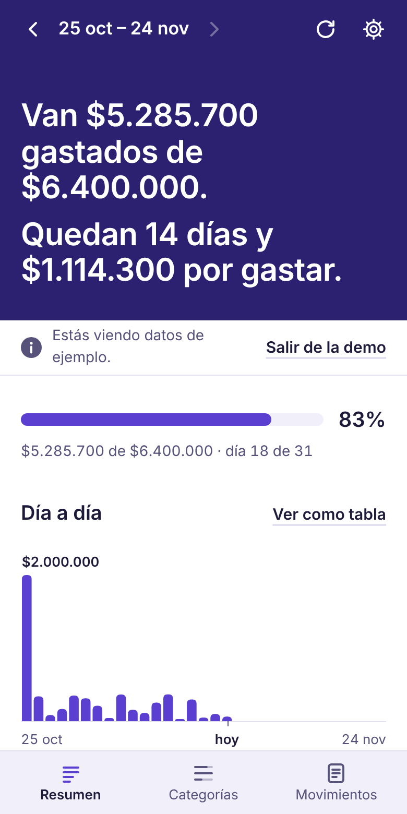
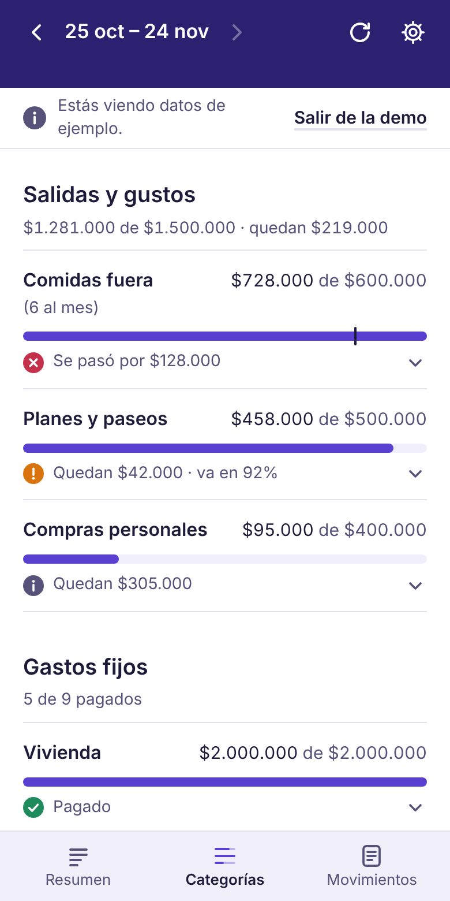
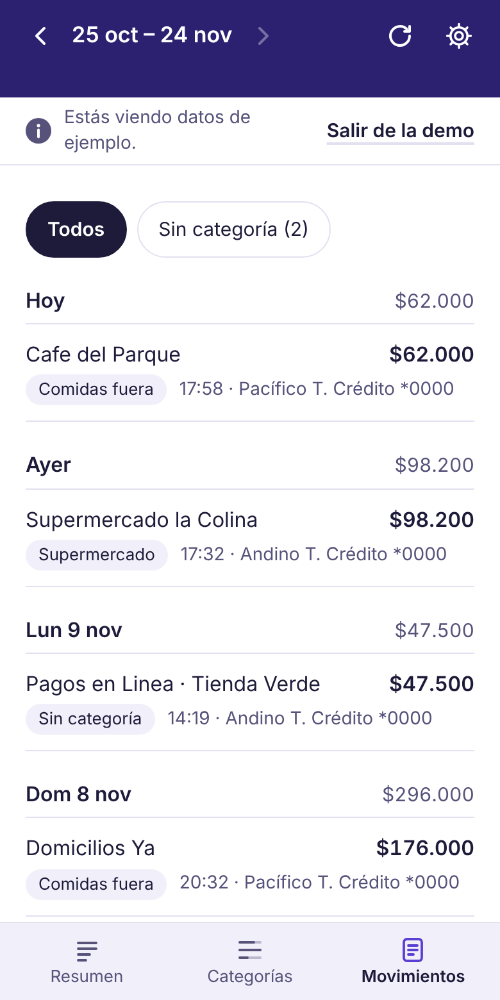
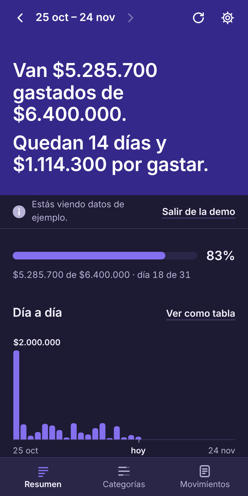
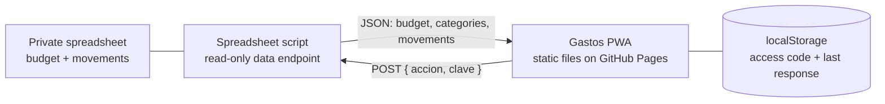

# Gastos

Gastos is an installable web app (PWA) that tells a household how its spending is going in the current pay cycle. It leads with plain sentences ("Van $5.285.700 gastados de $6.400.000. Quedan 14 días y $1.114.300 por gastar.") and uses charts and figures to back them up. The interface is in Spanish (Colombia); the code and documentation are in English.

**This repository holds no data.** It is only the app. Expenses, budget lines and settings arrive at run time from a private spreadsheet, through a read-only endpoint, using an access code that only the people meant to see the numbers have.

To try it with invented data, open the site linked in this repository's About panel and add `#demo` to the address.

| Summary | Categories | Transactions | Dark mode |
|---|---|---|---|
|  |  |  |  |

All screenshots show the built-in demo data.

## Contents

- [What it does](#what-it-does)
- [How it works](#how-it-works)
- [Data contract](#data-contract)
- [Access codes](#access-codes)
- [The logic](#the-logic)
- [Offline and installation](#offline-and-installation)
- [Privacy and security](#privacy-and-security)
- [Tech stack](#tech-stack)
- [Project structure](#project-structure)
- [Running it locally](#running-it-locally)
- [Tests](#tests)
- [Releasing a new version](#releasing-a-new-version)
- [Design notes](#design-notes)
- [Limitations](#limitations)

## What it does

The app has three views, switched with a tab bar at the bottom.

**Resumen (summary)**
- A headline in sentences: how much has been spent out of the budget, how many days are left and how much is still available. A closed cycle is described in the past tense.
- A meter of spent versus budget.
- "Día a día": one column per day of the cycle. Tapping or hovering a column shows that day's total and its largest movements. A toggle swaps the chart for a table of the same numbers.
- "Lo que hay que saber": a list of short sentences generated from the data. Each has a status glyph, so meaning never depends on color alone. See [Insights](#insights) for the rules.

**Categorías (categories)**
- One row per budget line with a bar, "spent of budget" and a status line ("Quedan $X", "Se pasó por $X", "Sin pagos todavía", "Pagado").
- Three groups: outings and treats, fixed expenses, and categories that have spending but no budget line.
- Tapping a row expands the movements behind it.

**Movimientos (transactions)**
- Every movement of the cycle, grouped by day with a daily total.
- A filter for movements that still have no category.
- Movements marked as excluded or as income are shown muted and do not count as spending.

Other things the app does:

- Moves between pay cycles with previous and next buttons. The next button stops at the current cycle.
- Shows cached data immediately when opened and refreshes in the background. It refreshes again when it returns to the foreground with data more than five minutes old.
- Keeps working offline with the last data it received, and says how old that data is.
- Follows the system light or dark theme.
- Has a demo mode (`#demo` in the URL, or the "Ver una demo" button) with invented data generated relative to today's date.

## How it works

The app is a static site. It has no server of its own, no build step and no accounts. All it knows how to do is ask one endpoint for data and present it.



1. On first run the app asks for an **access code**. The code contains the endpoint URL and a key (see [Access codes](#access-codes)).
2. The app validates the code with a real data request before saving it.
3. On every open it renders the cached response at once, then requests fresh data.
4. A small adapter (`fromApi` in `logic.js`) converts the response into the app's internal model. Everything after that point is pure functions over that model: which pay cycle a date belongs to, the cycle summary, the sentences.
5. `app.js` renders the result and handles navigation, storage and the network.

How the movements get into the spreadsheet is outside this repository. The reference setup is a Google Sheet with a bound Google Apps Script web app, where another automation records each movement as a row. Any backend that implements the [data contract](#data-contract) below would work, as long as its URL passes the access-code check.

## Data contract

### Request

`POST <endpoint>` with a plain string body and **no `Content-Type` header**:

```json
{ "accion": "datos", "clave": "<key>" }
```

Sending a string body without a content type makes the browser use `text/plain`, which keeps this a "simple" cross-origin request with no preflight. Google Apps Script web apps do not answer `OPTIONS` requests, so this matters. The script replies with a redirect to its content host, which `fetch` follows.

### Successful response

The field names are Spanish because they mirror the spreadsheet. The values below are invented.

```json
{
  "ok": true,
  "generado": "2026-01-15T09:30:00-05:00",
  "config": {
    "diaCorte": 25,
    "tarjetas": [ { "nombre": "Tarjeta Andino", "dia": 14 } ]
  },
  "presupuesto": {
    "ingreso": 8000000,
    "ahorroMeta": 1600000,
    "presupuesto": 6400000,
    "lineas": [
      { "nombre": "Vivienda", "monto": 2000000, "grupo": "fijo" },
      { "nombre": "Comidas fuera (6 al mes)", "monto": 600000, "grupo": "salidas" }
    ]
  },
  "categorias": ["Vivienda", "Comidas fuera", "Otros", "Ingreso", "No contar", "Sin categoría"],
  "movimientos": [
    {
      "fecha": "2026-01-14", "hora": "20:32", "banco": "Andino", "tipo": "Compra",
      "monto": 62000, "comercio": "CAFE DEL PARQUE", "producto": "Andino T. Crédito *0000",
      "categoria": "Comidas fuera"
    }
  ]
}
```

| Field | Meaning |
|---|---|
| `generado` | When the response was built (ISO 8601 with offset). |
| `config.diaCorte` | Day of the month a pay cycle starts on. Defaults to 25 when missing. |
| `config.tarjetas` | Cards with the day of the month their payment is due. |
| `presupuesto.ingreso` / `ahorroMeta` / `presupuesto` | Income per cycle, savings goal and total budget. |
| `presupuesto.lineas[]` | Budget lines. `grupo` is `fijo` (fixed expense) or `salidas` (outings and treats). |
| `categorias` | The category names in use. |
| `movimientos[]` | One entry per movement. `fecha` is a local `yyyy-MM-dd` date and `hora` is `HH:mm` or empty. |

Three category values have a special meaning: `No contar` (excluded from spending, for example paying a credit card bill whose purchases are already listed), `Ingreso` (income) and `Sin categoría` (not categorized yet). A movement whose `tipo` is `Ingreso` is also treated as income.

### Failed response

```json
{ "ok": false, "error": "clave" }
```

`"clave"` means the key is wrong or has been revoked. The app then forgets the stored code and returns to the setup screen. Any other `error` value is shown as a message with a retry button.

## Access codes

An access code is the URL-safe base64 encoding, without padding, of this JSON:

```json
{ "u": "<endpoint URL>", "k": "<key>" }
```

The app accepts a code only when:

- it decodes to valid UTF-8 JSON with string `u` and non-empty string `k`;
- `u` starts with `https://script.google.com/macros/s/` and ends with `/exec`, with no query string, fragment or whitespace;
- a real data request made with it succeeds.

The decoded pair and the last successful response are kept in `localStorage` under `gastos:access` and `gastos:cache`. Every storage access is wrapped in `try/catch`, so the app still works (without remembering anything) where storage is unavailable.

The key gives **read-only** access. Issuing a new key on the backend makes every older code stop working.

## The logic

Everything in this section lives in `logic.js`, has no DOM access, and is covered by tests.

### Dates and pay cycles

- Dates are handled as local `yyyy-MM-dd` strings and converted to day numbers by parsing the parts. The code never calls `new Date("yyyy-MM-dd")`, which would shift days depending on the time zone. The tests run under five time zones and require identical results.
- A pay cycle starts on the cut-off day of a month and ends the day before the next cut-off. With a cut-off of 25, a cycle runs from the 25th to the 24th. If a month is shorter than the cut-off day, the cycle starts on that month's last day.

### Matching categories to budget lines

Category names are usually shortened versions of budget line names ("Comidas fuera" versus "Comidas fuera (6 al mes)"). Names are normalized (lowercase, trimmed, accents removed) and a category is assigned to the line whose name starts with the category's name, or the reverse. The longest match wins. Categories with no line are reported separately as unbudgeted.

### Cycle summary

For a given cycle and today's date, `summary()` computes:

- total spent, budget, amount still available, days elapsed and days left;
- per budget line: spent, remaining, percentage and a status
  - `no-payments`: nothing spent
  - `on-track`: under 85% of the line
  - `close`: 85% to 100%
  - `over`: above 100%
- for fixed lines, `paid` when at least 90% of the amount has been spent;
- spending in categories without a budget line, and the count and sum of uncategorized movements (they count toward the total);
- for the outings group: budget, spent, remaining, and the amount per day that is left until the cycle ends;
- a projection: spent so far plus whatever remains unspent in every line, and the savings that would result (income minus projection) compared with the savings goal;
- one entry per day of the cycle for the chart, the largest single movement, and each card's next due date;
- whether the cycle is partial, meaning tracking began after the cycle started.

### Insights

`headline()` produces the opening sentences and `insights()` the list, each item with a tone (`good`, `warn`, `bad`, `info`). An item appears only when it applies, in this order:

1. Projected savings against the goal. Omitted for a partial cycle, where the figure would be misleading.
2. What is left for outings and treats, and how much that is per day.
3. Budget lines that are over, largest overrun first (up to three).
4. Budget lines that are close to their limit (up to two). Fixed expenses that are already paid are skipped.
5. How many fixed expenses appear as paid, and which are missing.
6. Uncategorized movements and their sum.
7. The largest purchase of the cycle.
8. Card payments due within the next seven days.
9. A note when the cycle is partial.

Amounts are formatted by hand as Colombian pesos (`$1.240.000`, no decimals) so that every browser and Node agree, instead of relying on `Intl`.

## Offline and installation

- `sw.js` precaches the app shell (HTML, scripts, manifest, icons) under a versioned cache name and serves it cache-first. It never intercepts requests to other origins and never caches data.
- Data is cached by the app itself in `localStorage`, as the raw last response. When the network fails, the app keeps showing it with a line saying when it was fetched.
- The service worker removes older caches when a new version activates.

To install:

- **iPhone or iPad:** open the site in Safari, tap Share, then "Add to Home Screen". Paste the access code inside the installed app: on iOS an installed web app has its own storage, separate from Safari.
- **Android (Chrome):** open the menu and choose "Install app" or "Add to Home screen".
- **Desktop Chrome or Edge:** use the install icon in the address bar.

## Privacy and security

- No analytics, no third-party scripts, fonts or images. The only network request the app ever makes, apart from loading its own files, is the data request.
- A Content Security Policy restricts everything to the app's own origin and allows connections only to `script.google.com` and `script.googleusercontent.com`. There are no inline scripts.
- `noindex` and `no-referrer` meta tags are set.
- The endpoint URL and key never appear in this repository or in any URL. They live inside the access code and in the device's `localStorage`.
- The request carries the key in the POST body, not in a query string.
- The endpoint is read-only and never returns the raw text of bank messages.

Anyone who has an access code can read the data it unlocks, so codes should be shared only with the people meant to see it.

## Tech stack

| Area | Choice |
|---|---|
| Language | Plain JavaScript (ES5-style, no transpiler), HTML and CSS |
| Frameworks and dependencies | None. No build step, no package manager, no runtime dependencies |
| Charts | SVG drawn by hand, sized from the container and redrawn on resize and theme change |
| Styling | One stylesheet inside `index.html`, CSS custom properties, `prefers-color-scheme` for dark mode |
| PWA | Web app manifest and a hand-written service worker |
| Storage | `localStorage` |
| Tests | Node.js built-in `assert`, no test framework |
| Hosting | GitHub Pages, served from the repository root |
| Backend (not in this repo) | Google Apps Script web app bound to a Google Sheet |

## Project structure

```
index.html              Markup and all CSS
logic.js                Pure logic: dates, cycles, matching, summary, sentences,
                        the wire adapter, access-code decoding, demo data
app.js                  State, storage, network, rendering, charts, navigation
sw.js                   Service worker: app-shell cache, version
manifest.webmanifest    Install metadata
icons/                  App icons (180, 192, 512, maskable 512)
tests/logic.test.js     Tests for everything in logic.js
docs/screenshots/       Images used in this README
.nojekyll               Tells GitHub Pages to serve the files as they are
```

`logic.js` works both in the browser (as `window.Gastos`) and in Node (through `module.exports`), which is what lets the tests run without a browser.

## Running it locally

Any static file server works. For example:

```sh
python3 -m http.server 8000
```

Then open `http://localhost:8000/#demo`. Every path in the app is relative, so it runs from any folder or sub-path.

The service worker only registers in a secure context, which includes `localhost`. To use real data locally you need an access code for a backend that implements the data contract.

## Tests

```sh
node tests/logic.test.js
```

The suite covers cycle boundaries across month lengths and year changes, category matching, every field of the summary, each insight rule firing and not firing, peso formatting, the wire adapter and access-code validation. It re-runs itself under several time zones and fails if any result differs.

## Releasing a new version

1. Change `VERSION` in `sw.js`. This renames the cache, so installed apps pick up the new files.
2. Push to `main`. GitHub Pages publishes the root of the branch.

Installed apps update the next time they are opened with a connection; the new version takes over on the following launch.

## Design notes

- **Sentences first.** The headline block is the one loud element. Everything below it sits on a plain surface with hairlines instead of cards.
- **Palette** drawn from Colombian peso banknotes: violet for data, green, orange and red for status. Light and dark mode each have their own set of steps, checked for contrast and for separation under color-vision deficiency.
- **One data hue.** Status colors appear only on a glyph or mark next to text that says the same thing. Text is never colored with a data or status color.
- **System typefaces** chosen for phones, with tabular figures for amounts. No web fonts are downloaded.
- **Accessibility:** real buttons with accessible names, visible keyboard focus, touch targets of at least 44px, a table alternative to the chart, `prefers-reduced-motion` respected, and layouts that hold from 320px up to tablet width.

## Limitations

- The interface is Spanish only, and amounts are formatted as Colombian pesos.
- Access codes are accepted only for Google Apps Script web app URLs.
- The app is read-only: categorizing or editing movements happens in the spreadsheet.
- A movement counts in the cycle that contains its date. A purchase paid in installments appears only if the spreadsheet lists each installment as its own row.
- There is one shared view: everyone with the code sees the same data.
